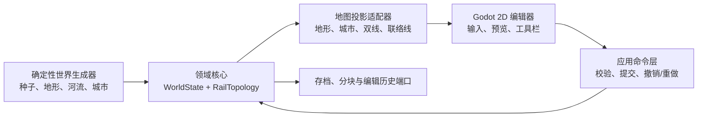
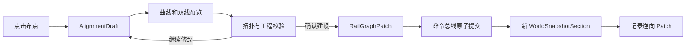

# 世界生成、宏观地图与铁路拓扑编辑设计规格

**日期：** 2026-07-29

**状态：** 已实现并通过自动化验收（81/81 测试与 Godot UI 冒烟）

**所属子项目：** 总产品规格第 2 阶段

**技术基线：** Godot 4.6.3 .NET、C#、.NET 8

## 1. 目标

本子项目交付第一个可见、可编辑、可保存的铁路建设纵向切片：

1. 使用固定种子生成虚构大区的地形、主要河流、城市和车站锚点。
2. 在 Godot 2D 宏观地图中平移、缩放和查看分级细节。
3. 用控制点曲线绘制 A—C—D—B 双线干线。
4. 在 D 附近建立与线路二相接的双向联络线。
5. 放大后检查独立上下行物理轨道、拓扑节点和允许的连接方向。
6. 对建设、改线、拆分、删除和互通操作执行原子提交、撤销与重做。
7. 保存并重新载入世界参数、生成结果和用户铁路编辑。

本阶段必须产生一个可运行的 Godot 2D 编辑器增量，并继续支持纯 C# 无界面验证。

本文细化总产品规格
`2026-07-27-china-railway-simulator-design.md` 的第 2 个实施子项目。若总规格对本阶段的描述与本文存在粒度差异，以本文为本阶段验收依据；详细站场、信号、列车、时刻表和调度仍按总规格后续阶段实施。

## 2. 已批准的产品决策

### 2.1 首版默认体验

- 采用可见的宏观 2D 可玩纵向切片，不先做纯无界面拓扑工具。
- 采用确定性的简化高程场、主要河流、四级城市和可保存生成参数。
- 一次宏观线路绘制默认生成上下行两股独立物理轨道。
- 线路走向采用“点击布点、拖动调整、自动平滑”的控制点曲线交互。
- 首个验收场景同时包含双线干线和 D 附近双向联络线。
- 普通线路相交默认不互通，只有显式建设连接时才改变行车拓扑。
- 默认世界为大区级 50–100 站规模，但坐标、分块、存档和加载架构必须允许未来升级至类似中国国土尺度、多个特大城市和多个特大站。

### 2.2 选择代表实施顺序，不代表永久排除

以下未作为首版默认的能力必须保留稳定替换端口和契约测试：

- 逐股物理轨道绘制。
- 只保存抽象线路走廊的宏观投影。
- 自由手绘线路输入。
- 地形感知自动选线。
- 手绘或外部来源地形。
- 手动城市布局或外部城市数据。
- 完整事件溯源编辑历史。
- 其他 2D、3D 或专业工作台投影。

不得以“以后再重构”为由把这些能力绑定死在 Godot 场景、固定数组或首版生成算法中。

## 3. 方案与边界

### 3.1 采用的方案

采用“领域核心驱动的可玩纵切片”：



领域核心是唯一权威状态，不依赖 Godot 类型。Godot 只收集输入、显示草案、提交命令和投影不可变快照。

### 3.2 不采用的主方案

- **完整事件溯源：** 回放与版本历史能力强，但首版的数据迁移和调试复杂度过高。当前只保留可逆 Patch 与历史存储端口。
- **Godot 场景优先：** 原型较快，但会把拓扑、存档和渲染耦合，无法稳妥支撑无界面测试、大陆级分块和后续调度仿真。

### 3.3 与现有基础核心的衔接

- 世界状态以不可变 `WorldSnapshotSection` 实现现有
  `ISimulationSnapshotSection`，使用稳定键 `world`。
- 世界修改通过现有 `ISimulationCommand`、`ICommandHandler` 和
  `SimulationCommandBus` 进入确定性命令边界。
- 编辑器读取现有 `ISimulationQuery` 发布的最新快照，不持有可写领域集合。
- 命令执行结果继续使用稳定错误码；Godot 自行映射中文界面文案。
- 世界生成与静态编辑不改变已经确定的固定仿真时钟语义。

## 4. 世界尺度、坐标和分块

### 4.1 可配置尺度

`WorldScaleProfile` 至少定义：

- `Regional`：首版默认，建议约 `1000 × 800 km`，50–100 个车站锚点。
- `Continental`：未来类似中国尺度的世界配置，不在首版生成完整内容，但必须通过坐标、序列化和分块契约测试。
- `Custom`：显式世界范围、区块尺寸、城市和车站分布参数。

地图宽高、城市数、车站数和各等级数量均来自参数，不得作为固定数组长度或枚举上限。

### 4.2 两级坐标

- 持久化世界坐标使用 64 位定点值，以毫米为最小存储单位。
- 地形和宏观算法可在明确量化边界内使用米制局部浮点计算。
- 轨道曲线、站场和未来道岔在区块或详细区局部坐标系内计算。
- Godot 使用相机相对坐标和动态显示原点，不把大陆级全局坐标直接长期保存在渲染节点的单精度位置中。
- 屏幕坐标只属于投影层，不能写回物理长度或拓扑。

这种设计允许宏观距离达到数千公里，同时在详细站场内保留亚米级编辑精度。

### 4.3 世界分块

- 世界由稳定 `WorldChunkId` 标识的规则区块组成。
- 地形采样、城市索引、轨道几何索引和渲染资源均可按区块加载。
- 跨区河流由世界级河流骨架约束，区块只保存本区段，避免边界断流。
- 跨区轨道对象仍使用全局稳定 ID；几何可分段索引，但不得因为卸载区块而改变领域身份。
- 当前视口、邻近区块和被显式打开的详细区进入活动集，其他区块只保留轻量索引。
- 数据结构和渲染资源不得随整个物理地图面积线性常驻内存。

首版可以一次加载默认大区，但接口和数据格式必须按分块定义，不能先落成不可迁移的单块巨型世界。

## 5. 确定性世界生成

### 5.1 生成参数

`WorldGenerationParameters` 至少包含：

- 主种子。
- 生成器版本。
- `WorldScaleProfile` 和世界边界。
- 区块尺寸与默认高程采样精度。
- 地形尺度、山地强度、海拔范围。
- 主要河流数量和宽度等级分布。
- 城市数量、四级城市比例、最小间距和地形适宜度权重。
- 车站锚点数量和等级分布。
- 名称包标识。

参数对象不可变、可序列化、可验证，并参与内容指纹计算。

### 5.2 独立随机流

主种子使用稳定派生函数产生至少以下独立随机流：

- `terrain`
- `rivers`
- `cities`
- `stations`
- `names`

派生键和算法版本属于存档契约。修改城市规则时不得无缘无故改变已生成山脉；修改名称包时不得改变城市位置。

### 5.3 地形

- 首版生成默认约 `512 × 384` 的区域高程场，实际精度由参数和区块配置决定。
- 使用固定算法和固定采样顺序叠加多尺度地形信号，形成平原、丘陵和山地。
- 算法输出在领域边界量化，避免不同运行平台的细小浮点差异扩散为不同世界。
- 生成结果保存内容哈希；同版本、同参数、同种子必须重复得到相同哈希。
- 地形编辑本阶段不实现，但 `ITerrainSource` 和
  `ITerrainEditService` 必须允许未来叠加画笔、高度图或外部数据。

### 5.4 河流

- 在高处选择确定性水源，使用受下降趋势约束的路径生成主要河流。
- 河流最终表示为有序世界坐标折线和宽度等级，不创建逐水滴实体。
- 河流可以跨区块，但必须保持连续 ID、方向和几何衔接。
- 视觉合理性是本阶段目标，不宣称实现完整水文学模拟。

### 5.5 城市与车站

城市优先布置在平缓、靠近河流且满足同级最小间距的位置。默认 `Regional` 示例建议生成 64 个城市：

- 特大城市 2 个。
- 大城市 8 个。
- 中等城市 18 个。
- 小城市及城镇 36 个。

数量只是默认配置，不是硬限制。

城市和车站不得一一绑定：

```text
CitySite 1 ── 0..N StationAnchor
```

- `CitySite` 保存城市位置、人口等级、名称和稳定 ID。
- `StationAnchor` 保存独立的车站等级、位置、所属城市可选引用和未来详细区引用。
- 一个特大城市可以有多个特大或大型枢纽。
- 一个普通城市也可以因线路交汇形成特大站。
- 未来允许无城市归属的线路所、越行站、货站、动车所和编组站锚点。

首版可为默认城市各生成一个客运站锚点，但领域约束和序列化不得假设这一对应关系。

## 6. 铁路拓扑模型

### 6.1 对象

| 对象 | 职责 |
|---|---|
| `RailNode` | 线路端点、宏观车站边界或联络线接入点 |
| `RailPort` | 节点上具有方向和连接语义的轨道端口 |
| `Alignment` | 控制点与平滑曲线形成的空间走向，不代表行车互通 |
| `TrackEdge` | 一股独立物理轨道，连接两个端口 |
| `TrackGroup` | 一次宏观建设生成的轨道集合，用于编辑和投影分组 |
| `TrackConnection` | 明确允许从一股轨道端口进入另一股轨道端口 |
| `StationAnchor` | 宏观车站占位和未来详细站场的稳定边界 |
| `RailTopology` | 不可变节点、端口、曲线、轨道、分组和连接集合 |

所有对象使用稳定 ID。显示名称、集合顺序和数组下标不得作为引用键。

### 6.2 几何与拓扑分离

- 控制点只影响 `Alignment` 几何，不会自动成为 `RailNode`。
- 普通线路在屏幕和世界坐标中交叉时，默认是立体交叉。
- 只有显式建设联络、平交道岔或节点合并时才创建端口和
  `TrackConnection`。
- `Alignment` 保存量化曲线、计算物理长度和地形采样摘要。
- 宏观投影可以压缩距离或合并双线显示，但列车运行和时刻表未来只使用物理长度。

### 6.3 双线语义

一次默认宏观绘制由 `DoubleTrackCorridorStrategy` 生成：

- 两个方向相反、ID 不同的 `TrackEdge`。
- 各自独立的起终端口和几何偏移。
- 一个只用于分组的 `TrackGroup`。
- 必要的车站边界连接，但不创建未明确要求的跨线互通。

每股轨道未来可独立限速、封锁、占用、改线和删除。拆分
`TrackGroup` 不得破坏物理轨道身份。

### 6.4 联络线语义

D 附近的双向联络线表现为独立物理 `TrackEdge`，并为明确选择的方向分别创建 `TrackConnection`。

一个交汇点的所有入边不得自动两两连接。后续单渡线、双渡线、三角线、方向受限联络线和站场咽喉继续使用同一端口—连接模型。

### 6.5 详细站场升级边界

`StationAnchor` 保留：

- 稳定站点 ID。
- 宏观边界端口。
- `DetailZoneId` 可选引用。
- 宏观端口到详细接口轨的映射位置。

下一子项目把车站展开成详细轨道、道岔和站台时，不更换车站 ID，也不要求迁移宏观线路引用。

## 7. 线路输入与编辑体验

### 7.1 首版工具

- 地图平移、缩放、单选和框选。
- 控制点双线绘制。
- 拖动、增加和删除控制点。
- 自动曲线平滑与双线偏移预览。
- 端点吸附到车站锚点、既有轨道端口或联络接入点。
- 双向联络线创建和允许方向选择。
- 轨道拆分、删除和互通断开。
- 撤销与重做。

首版 UI 默认展示易用参数；曲线半径、坡度、线间距和更严格工程参数可放在可展开的专业选项区域或先仅显示警告。专业选项的数据端口不得被删除。

### 7.2 草案生命周期



- 指针移动和控制点拖动只更新编辑器草案。
- 正式快照只在命令成功后更新。
- 草案记录其基于的世界修订号。
- 世界发生变化后，旧草案必须重新校验，不能盲目覆盖新状态。

### 7.3 策略端口

`IAlignmentSketchStrategy` 把输入事件转换成统一、可验证的
`AlignmentDraft`：

- 首版：`ControlPointSplineStrategy`。
- 未来：`FreehandSampleStrategy`。
- 未来：`TerrainAwareAutoRouteStrategy`。

`ITrackPlacementStrategy` 把有效草案展开成轨道 Patch：

- 首版：`DoubleTrackCorridorStrategy`。
- 未来：`SingleTrackStrategy`。
- 未来其他多线、复线或模板策略。

`IMacroTopologyProjection` 允许未来只显示抽象走廊，但抽象显示不得取代领域物理轨道。

## 8. 原子事务、撤销与重做

### 8.1 RailGraphPatch

一次玩家确认生成一个类型化 `RailGraphPatch`，至少记录：

- 基础世界修订号。
- 新增对象。
- 删除对象及删除前完整值。
- 替换对象的前值和后值。
- 受影响的区块和空间索引键。
- 校验结果中的已确认工程警告代码。

Patch 不保存 Godot 节点、屏幕坐标或界面状态。

### 8.2 提交规则

- `ApplyRailEditCommand` 通过现有命令总线提交。
- 处理器先验证基础修订号和所有前置条件，再构造完整新拓扑。
- 双线、节点、端口和连接必须全部成功或全部不生效。
- 成功后发布新的不可变世界快照段。
- 失败返回稳定代码，不改变快照、空间索引和历史栈。

### 8.3 历史规则

- 每次成功提交同时生成可验证的逆向 Patch。
- 撤销通过命令应用逆向 Patch；重做重新应用正向 Patch。
- 执行撤销后再提交新编辑会清空重做栈。
- 首版撤销粒度为一次玩家确认。
- A—C—D—B 双线可作为一个事务，D 联络线作为另一个事务。
- 默认历史保存在会话中；`IEditHistoryStore` 允许以后保存完整历史、时间线或升级成事件溯源。

当前方案不是事件溯源。存档权威内容是当前世界状态和必要生成元数据；是否附带历史由存档策略决定。

## 9. 校验与错误处理

### 9.1 结构化结果

每条校验结果至少包含：

- 稳定代码。
- `Error` 或 `Warning` 严重级别。
- 相关领域对象 ID。
- 可选世界位置或线路里程。
- 可供界面格式化的参数。

领域核心不保存最终中文界面文案。Godot 可根据代码显示高亮、定位按钮和说明。

### 9.2 禁止提交的错误

- 不存在的节点、轨道、端口或区块引用。
- 重复稳定 ID。
- 非有限坐标、越出世界边界或退化为零长度的线路。
- `TrackConnection` 两端并非实际兼容的轨道端口。
- 双线只成功生成一股或事务对象不完整。
- 基础世界修订号过期。
- 删除被引用轨道却未在同一事务处理连接关系。
- 分块边界引用不能解析或稳定 ID 在重载后变化。

### 9.3 可覆盖的工程警告

- 曲线半径低于当前线路等级建议值。
- 坡度过大或连续反向曲线过密。
- 线路间距过近。
- 穿越主要河流或陡峭山地，未来可能需要桥梁、隧道。
- 联络方向不常见或可能形成较差运行路径。
- 宏观屏幕距离与物理距离差异过大。

覆盖警告必须由玩家明确确认，并把警告代码写入事务；不得把硬错误降级为警告。

## 10. Godot 2D 投影

### 10.1 分级细节

| 视角 | 内容 |
|---|---|
| 区域视角 | 地形色带、山脉阴影、主要河流、城市等级、线路标识 |
| 线路视角 | 上下行双轨、方向、车站锚点、联络线、交汇状态 |
| 编辑视角 | 独立轨道、控制点、吸附端口、连接方向、校验提示 |
| 站场视角 | 本阶段显示稳定占位边界；下一阶段接入详细站场 |

远距离双线可以合并成一条线路标识，但领域物理轨道、ID 和连接关系始终存在。

### 10.2 渲染和更新

- 地形区块生成后烘焙成纹理或等价批量资源，不为每个高度格创建 Godot 节点。
- 河流、城市和轨道使用空间索引与视口裁剪。
- `IMapLodPolicy` 决定样式和阈值。
- `IWorldProjection` 把不可变世界快照转换成 Godot 可消费的只读投影数据。
- 新旧快照通过修订号和受影响区块执行局部刷新，不重建整个世界。
- 画质和 LOD 改变不得修改领域状态或物理长度。

### 10.3 大陆级显示能力

- 使用相机相对坐标，必要时切换显示原点。
- 只加载视口和邻近区块。
- 城市、车站和线路在远距离聚合显示。
- 打开详细站场只加载目标 `DetailZone`，不加载所有站场。
- 宏观拓扑引用在区块卸载期间持续有效。

## 11. 存储与版本

### 11.1 首版保存内容

世界文档至少保存：

- 文档格式版本。
- `WorldGenerationParameters`。
- 生成器版本和内容哈希。
- 当前地形、河流、城市、车站锚点的必要分块数据或可验证再生成元数据。
- 当前 `RailTopology`。
- 世界修订号。
- 可选编辑历史。

重新加载后必须保持世界种子、地形哈希、稳定 ID、轨道几何、拓扑连接和玩家编辑一致。

### 11.2 存储边界

- `IWorldRepository`：保存和读取当前世界文档。
- `IWorldChunkStore`：按稳定区块 ID 读取或写入分块。
- `IWorldRegionProvider`：枚举区域元数据和活动区块。
- `IWorldStreamingPolicy`：决定预取、保留和卸载范围。
- `IEditHistoryStore`：可选保存编辑历史。

首版可提供本地 JSON/二进制混合实现，但领域对象不得依赖具体序列化库或文件路径。

## 12. 扩展端口清单

本子项目的稳定替换点为：

- `IWorldGenerator`
- `ITerrainSource`
- `ITerrainGenerator`
- `ITerrainEditService`
- `ICityPlacementStrategy`
- `INameGenerator`
- `IAlignmentSketchStrategy`
- `ITrackPlacementStrategy`
- `IRailEditValidator`
- `IMacroTopologyProjection`
- `IWorldProjection`
- `IMapLodPolicy`
- `IWorldRepository`
- `IWorldChunkStore`
- `IWorldRegionProvider`
- `IWorldStreamingPolicy`
- `IEditHistoryStore`

接口只放在真实替换边界上。领域值对象和简单算法内部不为“可能以后变化”而机械增加接口。

至少为以下替换关系编写契约测试：

- 不同 `IAlignmentSketchStrategy` 产生同一标准草案类型。
- 不同 `ITrackPlacementStrategy` 产生可被同一拓扑校验器接受的 Patch。
- 不同 `ITerrainSource` 产生相同坐标和分块契约。
- 不同 `IWorldProjection` 不得修改领域快照。
- 不同 `IEditHistoryStore` 不得改变提交和撤销语义。

## 13. 测试策略

### 13.1 世界生成

- 同版本、同种子、同参数重复生成相同内容哈希。
- 独立随机流修改一个子系统时不改变无关子系统。
- 默认生成 64 个城市且等级数量正确。
- 配置 50 和 100 个车站锚点均能生成有效世界。
- 城市和车站支持一对多关系。
- 河流跨区块后 ID、方向和端点连续。
- 量化和序列化往返不改变坐标。

### 13.2 铁路拓扑

- 一次双线绘制生成两股独立、方向相反的 `TrackEdge`。
- 普通线路交叉不产生隐式端口或互通。
- 双向联络线只生成明确选择的连接方向。
- 拆分、删除和断开连接后不存在悬空引用。
- `TrackGroup` 删除或拆分不改变未删除物理轨道的身份。
- 详细站场引用为空或加载状态变化时，宏观端口保持有效。

### 13.3 事务与历史

- 成功事务的“提交→撤销”恢复原快照哈希。
- “撤销→重做”恢复提交后快照哈希。
- 失败事务不改变快照、历史或空间索引。
- 过期修订号被拒绝。
- 新提交正确清空重做栈。
- 双线的部分失败不会留下单股轨道。

### 13.4 Godot 集成

- 固定种子地图可启动并显示地形、河流、城市和站点锚点。
- 区域、线路和编辑三个 LOD 使用相同稳定 ID。
- 平移、缩放和切换 LOD 不改变核心快照。
- 控制点拖动只改变草案，确认后才发布世界状态。
- 警告和硬错误能定位到相应地图对象。
- 保存、退出、重新加载后显示与领域状态一致。

### 13.5 大陆级架构

本阶段不要求生成完整中国规模可玩内容，但必须有合成契约或压力测试验证：

- 大陆级世界边界坐标无溢出。
- 远离全局原点的局部轨道仍保持精度。
- 多个特大城市和多个特大站能同时存在。
- 一个城市可以引用多个特大或大型站点。
- 跨区线路和河流卸载、重载后稳定 ID 与拓扑一致。
- 活动内存由加载区块和详细区决定，不因空白地图总面积直接线性增长。

### 13.6 现有质量门

- Release 构建。
- Debug 构建。
- 全部纯 C# 测试。
- 覆盖率门槛。
- Godot 无界面启动冒烟测试。
- 验证脚本从干净检出状态可重复运行。

## 14. 性能目标

首版基准场景至少覆盖：

- 100 个城市或车站锚点。
- 代表性的宏观线路和联络线。
- 连续地图平移、缩放和 LOD 切换。
- 线路草案实时更新和局部校验。

要求：

- 正常编辑操作在 100 毫秒内给出视觉反馈。
- 拖动控制点时不执行全世界拓扑重建。
- 地形不采用逐格节点渲染。
- 编辑提交只重算受影响区块和拓扑索引。
- 性能基准记录耗时和分配趋势，防止明显回退。

大陆级能力依赖分块和流式加载，不要求首版把全国所有详细站场同时常驻内存。

## 15. 人工验收

1. 使用固定种子创建默认虚拟大区。
2. 地图显示简化山地、平原、主要河流和 50–100 个车站锚点。
3. 玩家平移、缩放并查看不同 LOD。
4. 使用控制点绘制 A—C—D—B 双线。
5. 拖动控制点，检查曲线、双轨预览和工程警告。
6. 创建线路二与主线的普通交叉，确认默认不互通。
7. 在 D 附近建立双向联络线。
8. 放大检查独立上下行轨道和允许的连接方向。
9. 连续撤销、重做干线与联络线事务。
10. 保存、退出并重新加载，确认世界和铁路编辑完全恢复。
11. 运行完整自动验证，无新增警告或失败。

## 16. 本阶段不实现

- 详细站场内部轨道、道岔、站台和咽喉。
- 信号机、检测区段、闭塞和联锁。
- 列车模型、列车动力学和运行位置。
- 时刻表、客流和上下客时间。
- 自动调度、玩家接管和专业 CTC 工作区。
- 地形画笔、外部 GIS 导入和自动工程选线。
- 完整事件溯源历史。
- 大陆级完整内容包和全国详细站场同时加载。

这些能力不是从架构中排除。稳定轨道 ID、物理长度、方向化连接、详细区引用、世界分块和扩展端口必须在本阶段建立其接入基础。

## 17. 完成定义

只有同时满足以下条件，本子项目才算完成：

- 第 15 节人工场景可完整执行。
- 第 13 节自动化测试与现有质量门全部通过。
- 所有首版默认策略通过其稳定接口使用，而非被 Godot 场景直接硬编码。
- 未选方案的接口端口和关键契约测试存在。
- 大陆级坐标、分块、多城市多车站关系通过架构测试。
- 规格、实现和验证命令保持一致。
